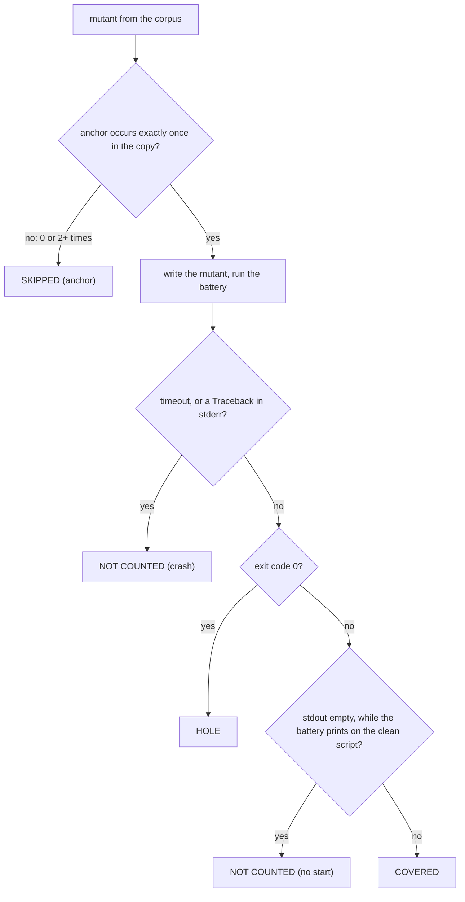

A small mutation checker that proves a test battery can catch a defect, with five distinct outcomes per mutant.


## Why

A green test battery tells you that the tests passed. It does not tell you that they would have noticed
a broken line. `mutate_check.py` answers that second question: it breaks one line of a copy of your
script at a time (a "mutant"), runs the battery against it, and reports whether the battery turned red.

The naive verdict "nothing turned red = a hole" produces false holes, so every mutant gets one of five
outcomes instead of two: a battery that crashed, or that died before running a single check, did not
catch anything, but it did not stay silent either. And a mutant that could not be applied is "not
checked", never "clean".

## Quick start

Standard library only, a single file. Tested on Python 3.14.

```
python mutate_check.py examples/textstats.py examples/test_textstats.py examples/mutations.json
```

The three arguments are the script under test, its battery (any Python script that exits non-zero when
a check fails) and the mutation corpus. The toy example has five mutants, one for each outcome.

The tool checks itself the same way (self-attestation, see below):

```
python mutate_check.py mutate_check.py test_mutate_check.py mutate_check.mutations.json
```

`python mutate_check.py --help` prints the full reference: flags (`--timeout`, `--save`, `--out`,
`--anchors-only`, `--only`), exit codes and the limits listed at the end of this page.

## Example output

The run above, on `examples/`:

```
Subject: examples/textstats.py
Battery: examples/test_textstats.py
Baseline: exit 0 (clean)

mutant                      outcome                       red tests / details
--------------------------  ----------------------------  ------------------------------
hole-max-words-constant     HOLE                          exit=0, same as baseline - nothing turned red
covered-unique-always-adds  COVERED                       t3 unique-words-ignore-repeats
crash-mean-guard-removed    NOT COUNTED (crash)           battery crashed: ZeroDivisionError: division by zero
no-start-exit-on-import     NOT COUNTED (no start)        exit=2, battery stdout empty - no check executed (died before start, e.g. sys.exit on import)
skipped-ambiguous-anchor    SKIPPED (anchor)              anchor occurs 2 times (need 1)

Total: COVERED 1 · HOLE 1 · NOT COUNTED 2 (crash 1 · no start 1) · SKIPPED 1
HOLES in the battery: a mutation went UNNOTICED.
WARNING: on some mutants the battery crashed with an unhandled exception - that is not a check; fix the exception handling in the battery.
WARNING: on some mutants the battery exited non-zero without printing A SINGLE line - zero checks executed, the catch is not proven. A check that catches this defect is needed, not the death of the battery before its start.
WARNING: some mutants have an anchor that is not unique in the copy - the mutation was not applied; recheck the anchor.

(result not saved anywhere - the --save flag gives a durable record)
```

The exit code of this run is 1: the corpus has a hole, two mutants that were not counted and one
that was skipped.

## How it works

A mutant is a JSON object with a name, an `anchor` (the exact text to find) and its `replace`:

```json
{"name": "covered-unique-always-adds",
 "anchor": "        if word not in seen:\n",
 "replace": "        if True:\n"}
```

The script folder is copied into a temporary directory; the original is never opened for writing. The
anchor must occur exactly once in the copy, counted with overlaps and measured in both line-ending
forms (LF and CRLF). Each mutant is written into the copy, the battery runs, and the clean text is
written back before the next mutant. The outcome is decided in this order:



The verdict is 0 only when every mutant is COVERED; a HOLE, either NOT COUNTED or a SKIPPED gives 1;
2 means the check could not run (the battery is not green on the clean script, a file is missing, the
corpus is broken, or the result could not be written).

## Self-attestation

`mutate_check.mutations.json` is a corpus of mutants of `mutate_check.py` itself, run against its own
battery `test_mutate_check.py`; the committed result is `mutate_check.mutations-result.json`.

Self-attestation: COVERED 27 of 30

```
Total: COVERED 27 · HOLE 3 · NOT COUNTED 0 (crash 0 · no start 0) · SKIPPED 0
```

The three holes, named as they are:

- HOLE `verdict-ignores-crash` - the exit code is no longer 1 when the only uncounted outcome is a crash; no check in the battery runs a corpus where a crash is the only problem.
- HOLE `rollback-after-mutant-skipped` - the write that restores the clean text after each mutant run was removed, and no check turned red. What is proven is only that: the battery does not observe this rollback. The likely reason is that every mutant is written from the clean text kept in memory, which would make the mutant equivalent, but that equivalence is not proven.
- HOLE `short-path-always-absolute` - paths in the result file stay absolute instead of relative; the battery compares only base names, so nothing notices.

## How it differs from mutmut and Stryker

`mutate_check.py` is a single file that checks one battery against mutants you write by hand. Each
point below rests on the public documentation of the other tool, linked in the point.

- mutmut generates its mutants itself from the code, for example "Integer literals are changed by adding 1" ([mutmut README](https://github.com/boxed/mutmut/blob/main/README.rst)); Stryker does the same with its "mutators", for example one that "removes the content of every block statement" ([Stryker: supported mutators](https://stryker-mutator.io/docs/mutation-testing-elements/supported-mutators/)). Here every mutant is written by hand as an anchor and its replacement: you choose the defect the battery must catch.
- By default mutmut runs pytest on the tests in a "tests" or "test" folder ([mutmut README](https://github.com/boxed/mutmut/blob/main/README.rst)). Here the battery is any Python script, judged by its exit code and its output.
- mutmut needs `fork`, so on Windows it must run inside WSL ([mutmut README](https://github.com/boxed/mutmut/blob/main/README.rst)). `mutate_check.py` uses only the standard library and was developed and run on Windows.
- Stryker counts a timeout as "detected" ([Stryker: mutant states and metrics](https://stryker-mutator.io/docs/mutation-testing-elements/mutant-states-and-metrics/)). Here a timeout is NOT COUNTED (crash): a battery that never finished did not catch anything.
- Stryker also keeps a separate "Runtime error" state, for a run that "resulted in an error (rather than a failed test)" ([Stryker: mutant states and metrics](https://stryker-mutator.io/docs/mutation-testing-elements/mutant-states-and-metrics/)). This is the closest counterpart of NOT COUNTED (crash); NOT COUNTED (no start) and SKIPPED (anchor) come from the hand-written corpus.

## Prior art

A GitHub code search on 2026-11-17 for `mutations.json anchor replace mutant` returned 833 files in
322 repositories. What this tool does well, and where it is weaker, by its own code:

- Good: a standalone tool for any script and battery pair; it works only on a copy, and the original
  is never opened for writing.
- Good: five outcomes, all saved by name to the result file together with their vocabulary.
- Good: the anchor must occur exactly once, counted with overlaps and in both line-ending forms (LF and
  CRLF); `--anchors-only` checks the whole corpus without running the battery.
- Good: it attests itself on its own battery (see Self-attestation).
- Weaker: every mutant is written by hand; nothing is generated from the code (tools that generate
  mutants are compared in the section above).
- Weaker: mutants run one after another, each against the whole battery.
- Weaker: Python only; the battery must sit in the same folder as the script.
- Weaker: a timeout counts as NOT COUNTED (crash), and it is not retried.
- Weaker: it does not check WHICH test turned red: any non-zero exit with output and no traceback is
  COVERED.

## Limits

- The script and its battery must lie in the same folder: that folder is what gets copied.
- The battery runs as `python <battery>` with the same interpreter, and is judged by its exit code,
  its stdout and a `Traceback` in its stderr.
- The "no start" sign is the absence of any output, and it has four limits named in the tool's help:
  (1) a subject that prints to stdout before dying on import is not caught by it; (2) a battery that is
  silent already on the clean script is beyond the sign, and its non-zero exit stays COVERED with a
  note in `detail`; (3) a battery that printed some checks and was then killed by the subject stays
  COVERED; (4) a battery that speaks on the clean script but reports a caught defect only through its
  exit code or stderr lands in NOT COUNTED (no start) by mistake.
- A battery written with `unittest` is misread: a failing `unittest` check prints a Python traceback,
  so a caught mutant is reported as NOT COUNTED (crash).
- Tested on Python 3.14, on Windows only.

## License

MIT, see [LICENSE](LICENSE).
